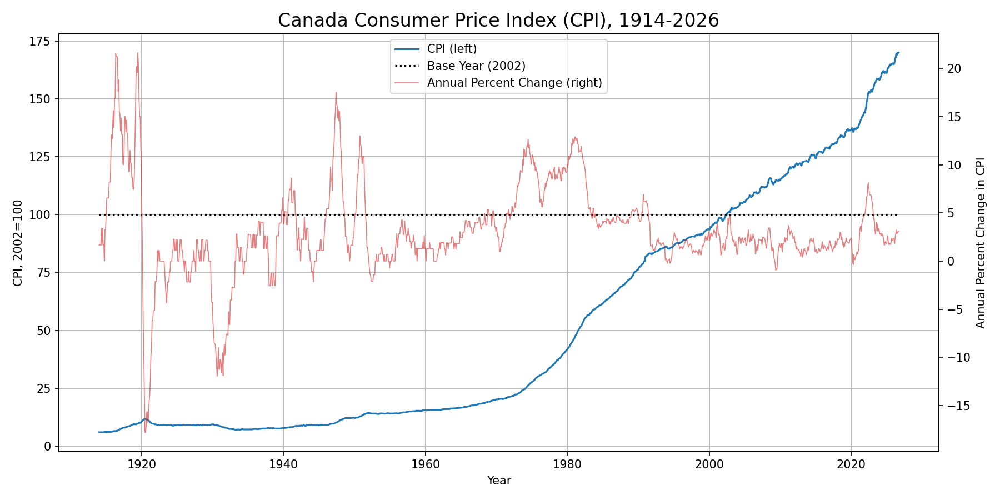

# FINE3300-2026-A2
# Consumer Price Index (CPI) Analysis

## Introduction
This assignment 2 reads the Canadian CPI information from the Bank of Canada and calculates its annual percentage change, graphs the CPI, as well as replicating the inflation calculator on their webpage (provided below).

(https://www.bankofcanada.ca/rates/related/inflation-calculator/)

Originally, the calculator takes years, although modifications were made to accept a month and a year due to data being set monthly.

## Description of Files

### STATIC-INFLATIONCALC.csv

Bank of Canada monthly total CPI, containing data from January 1914 to September 2026 using 2002 as a benchmark.

### cpi_calc.py

Contains a class that loads the csv data into Pandas, validates the data, and performs the necessary calculations for a given output of the required values

### cpi_graph.py

Draws the CPI graph with left and right axis's representing the CPI graph and the Annual Percentage Change, respectively.

Running this piece of code saves a png file of the graph.
-> "cpi_graph.png"

### cpi.graph.png

The saved graph

### README.md

Current file. Contains project introduction, description of files, and other relevant information.

## How to use

1. Must install required libraries -> pandas, numpy, matplotlib
2. Ensure files remain in the same folder
3. Refer to "cpi_graph.png" or in terminal: Run "python3 cpiy_graph.py"
4. For calculators (in terminal):  Run "python3 cpi_calc.py", then enter a valid price, following by a valid first and second date and month in "YYYY-MM" format.

## CPI Graph

#### Comments
* The index first crosssed the base level of 100 in July 2002
* CPI rose from 6.0 in January 1914 to 170.0 in September 2026
* Big spikes and falls are in relation to major world events such as WWI, WWII, The Great Depression, etc.
* Around the 1990s and onward, inflation has stayed relatively stable and low aside from the Covid-19 pandemic.

## Sample Output

Enter the amount: 100
Enter the first date (YYYY-MM): 2000-09
Enter the second date (YYYY-MM): 2026-09

Percent Change: 76.90%
Years between dates: 26.00
Annual Rate of Change: 2.22%
CPI on 2000-09: 96.10
CPI on 2026-09: 170.00
New Amount: 176.90